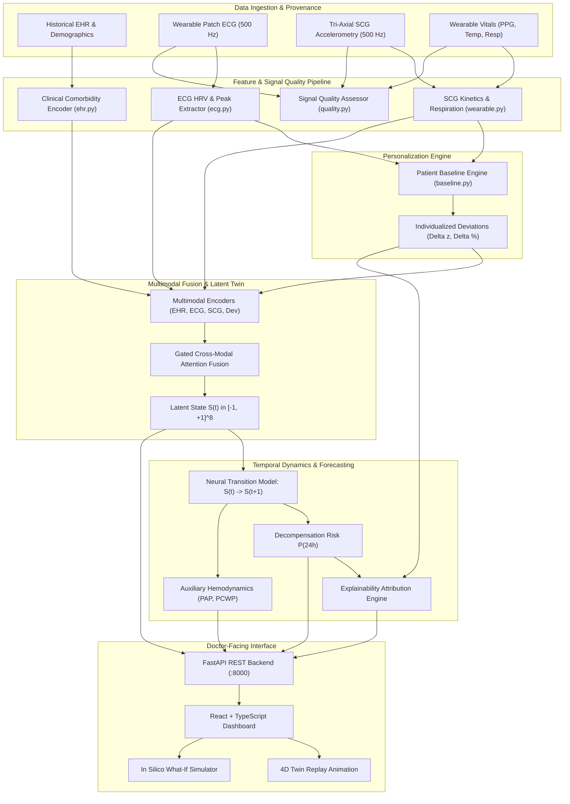

# HeartFailureTwin: System Architecture

## 1. High-Level Architecture Overview

HeartFailureTwin is engineered as a modular, decoupled research decision-support prototype. It avoids monolithic single-model designs by cleanly separating the **Clinical Profiling**, **Dynamic Physiological Ingestion**, **Patient-Specific Baseline Calibration**, **Digital Twin Latent State Space**, and **Temporal Trajectory Forecasting** layers.

---

## 2. Component Specifications

### 2.1 Multimodal Ingestion & Preprocessing
* **WFDB Engine**: Reads PhysioNet Waveform DataBase format (`.hea` and `.dat`) at 500 Hz without data loss.
* **Signal Quality Guard**: Computes continuous quality scores \([0.0, 1.0]\) measuring missingness, signal saturation, and signal-to-noise ratio (SNR).
* **Physiological Feature Extraction**:
  * **ECG**: R-peak detection, instantaneous heart rates, and time-domain HRV metrics (SDNN, RMSSD, pNN50).
  * **Seismocardiography (SCG)**: 1–40 Hz bandpass filtering isolating mechanical chest wall vibration, 3-axis RMS kinetic energy, dorso-ventral contractility force, and spectral centroids.
  * **Vitals**: Photoplethysmography perfusion index, respiration rate (breaths/min), and skin temperature.

### 2.2 Patient-Specific Baseline Engine (`twin/baseline.py`)
* Establishes individualized resting baseline ranges \([\mu_i, \sigma_i]\) for each monitored patient during initial calibrated observation.
* Rather than comparing patient values against broad population cutoffs, computes **personalized deviations**:
  $$\Delta z_{i, t} = \frac{x_{i, t} - \mu_{i}}{\sigma_i}$$
* Isolates genuine subclinical trajectory drift from lifelong idiosyncratic baselines.

### 2.3 Multimodal Gated Fusion & Latent State Space (`twin/state_estimator.py`)
* Maps 4 distinct modalities into 16-dimensional embedding spaces.
* Fuses modal embeddings through a non-linear cross-modal gating mechanism that dynamically weights modalities based on signal quality.
* Projects gated representations into an 8-dimensional normalized latent physiological state vector \(S(t) \in [-1, 1]^8\).

### 2.4 State Transition Model (`twin/state_transition.py`)
* Models state trajectory evolution \(S(t+1) = S(t) + f_\theta(S(t))\).
* Unrolls autoregressively to compute prospective risk estimates across prospective horizons (0h, 6h, 12h, 24h).

### 2.5 Doctor-Facing Interface & API
* **Backend**: FastAPI with async route execution, Pydantic schemas, and auto-generated Swagger UI (`/docs`).
* **Frontend**: React 19 + TypeScript + Vite + Tailwind CSS v4 + Recharts.
* **Twin Replay Controller**: Step-by-step 4D interactive temporal scrubber animating state badge transitions, vitals waveforms, and alert triggers.
* **What-If Simulation Engine**: In silico physiological modulation evaluating prospective trajectory shifts with prominent non-diagnostic medical disclaimers.
